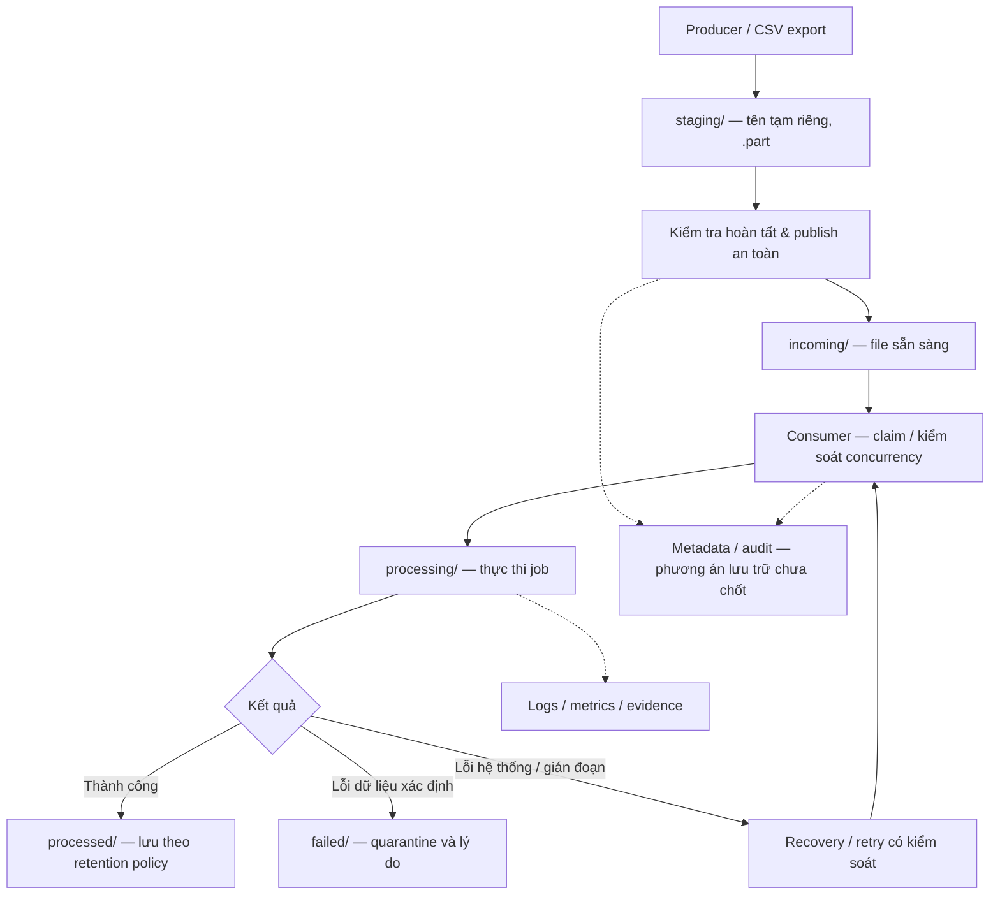

# Linux Data Processing Server

**Module 01 · Project 01 — Engineering Foundations | OmniCommerce Data Platform**

> Xây dựng một máy chủ xử lý file dữ liệu trên Linux, từ tiếp nhận CSV an toàn đến tự động hóa, chống xử lý trùng, giám sát và phục hồi khi gặp sự cố. Dự án mô phỏng những vấn đề một Data Engineer phải giải quyết khi vận hành batch ingestion trong doanh nghiệp.

**Trạng thái hiện tại:** Đang phát triển — giai đoạn Linux fundamentals, file lifecycle và thiết kế safe publication. **Chưa phải hệ thống production-ready.**

## 1. Tổng quan và bài toán nghiệp vụ

**Bối cảnh:** OmniCommerce là doanh nghiệp thương mại điện tử giả lập. Hệ thống đơn hàng xuất dữ liệu CSV theo từng đợt để chuyển đến máy chủ xử lý. Một số file lớn cần nhiều thời gian để ghi; file có thể bị gửi lại; nhiều producer hoặc worker có thể chạy đồng thời; job có thể bị dừng do lỗi hệ thống.

**Vấn đề:** Nếu chỉ quét thư mục rồi đọc file ngay, hệ thống có thể đọc file đang được upload, ghi đè file khác, xử lý cùng dữ liệu nhiều lần, để lại trạng thái dở dang khi crash và khó điều tra sự cố.

**Giải pháp hướng tới:** Một Linux-based file ingestion & processing pipeline có giao thức công bố file rõ ràng, trạng thái xử lý có thể theo dõi, quy tắc deduplication, kiểm soát concurrency và quy trình vận hành/khôi phục có bằng chứng kiểm thử.

### Giá trị của dự án

- **Đối với nghiệp vụ:** Giảm rủi ro đọc dữ liệu thiếu, xử lý trùng và mất khả năng truy vết từng batch dữ liệu.
- **Đối với kỹ thuật:** Thực hành Linux, filesystem, Bash scripting, process management, concurrency, failure handling, observability và testability.
- **Đối với portfolio:** Không chỉ có script chạy được, mà có requirements, architecture, ADR (Architecture Decision Record), failure scenarios và bằng chứng thực nghiệm.

## 2. Mục tiêu và kết quả đầu ra

| Mục tiêu | Kết quả phải chứng minh |
|---|---|
| Linux fundamentals | Giải thích và sử dụng được shell, path, filesystem, permission, process, exit code |
| Safe file ingestion | Consumer không đọc file đang được producer ghi dở |
| Concurrency safety | Hai producer/consumer không vô tình cùng ghi đè hoặc xử lý một tài nguyên |
| File-level deduplication | Phát hiện duplicate candidate bằng SHA-256 nhưng giữ được lịch sử tiếp nhận |
| Reliable processing | Có cơ chế nhận file, xử lý, hoàn tất và phân loại lỗi/recovery rõ ràng |
| Automation | Tác vụ chạy theo lịch và hạn chế job overlap |
| Observability | Có log, trạng thái lần chạy và phương pháp chẩn đoán lỗi |
| Operations | Có runbook và quy trình kiểm thử/khôi phục sau sự cố |
| Engineering evidence | Mỗi yêu cầu quan trọng có test case, kết quả chạy và giới hạn được ghi nhận |

**Phạm vi:** File-based batch ingestion trên một máy Linux/WSL2. Đây **không phải** distributed data platform, message broker, full-featured ETL warehouse hoặc lời hứa exactly-once end-to-end.

## 3. Công nghệ và kỹ thuật

| Nhóm | Công nghệ / kỹ thuật | Vai trò | Trạng thái |
|---|---|---|---|
| Môi trường | Ubuntu Linux / WSL2 | Môi trường học, thực nghiệm và vận hành local | Môi trường mục tiêu |
| Shell | Bash, GNU coreutils | Viết và chạy data jobs | Có demo Bash |
| Filesystem | `mkdir`, `mv`, `mktemp`, `stat`, `sha256sum` | Staging, publication, xác minh file | Đang học / thiết kế |
| Concurrency | `flock`, unique filename, atomic no-overwrite | Giảm race condition, ngăn ghi đè ngoài ý muốn | Chưa triển khai hoàn chỉnh |
| Process & scheduling | Process signals, exit codes, systemd timer / cron | Job lifecycle, scheduling | Dự kiến; chưa chốt scheduler |
| Reliability | Retry policy, crash recovery, idempotency boundary | Phục hồi có kiểm soát | Dự kiến |
| Operations | Logs, `journalctl`, disk/CPU/memory inspection | Quan sát, xử lý sự cố | Dự kiến |
| Quality | Shell tests, failure injection, test fixtures | Chứng minh hành vi an toàn | Kế hoạch kiểm thử |
| Documentation | Markdown, Mermaid, ADR, runbook | Lưu tri thức và giải thích quyết định | Đã có tài liệu ban đầu |

**Lựa chọn công nghệ là có chủ đích:** Project 01 ưu tiên Linux/Bash để hiểu nền tảng hệ thống. Python sẽ được học bài bản ở dự án Python ETL riêng, không phải điều kiện để bắt đầu dự án này. PostgreSQL, Kafka, Spark, Airflow cũng không phải dependency bắt buộc của phiên bản đầu tiên.

## 4. Kiến trúc mục tiêu



**Nguyên tắc:** `staging/` dành cho dữ liệu chưa công bố; `incoming/` chỉ chứa file được coi là sẵn sàng theo giao thức. Tên thư mục không tự chứng minh trạng thái logic: file trong `processing/` có thể đã bị bỏ lại sau crash.

**Lưu ý thiết kế:** Atomic rename phụ thuộc filesystem và không tự đảm bảo durability sau mất điện; thao tác trên filesystem và cập nhật metadata không tự động là một transaction chung.

## 5. Yêu cầu chức năng (Functional Requirements)

| ID | Yêu cầu | Hành vi mong muốn | Trạng thái |
|---|---|---|---|
| FR-01 | Setup môi trường | Có hướng dẫn chuẩn bị, xác minh Ubuntu/Linux và công cụ cần thiết | Chưa có setup script |
| FR-02 | Data directory lifecycle | Tách `staging/incoming/processing/processed/failed`, quy định trách nhiệm mỗi thư mục | Đã mô tả trong design |
| FR-03 | Safe file publication | Producer ghi file tạm, chỉ công bố sau khi hoàn thành; không vô tình overwrite | Demo cơ bản, chưa concurrency-safe |
| FR-04 | File identity & dedup | Từng lần nhận có ID riêng, SHA-256 nhận diện candidate, lưu audit | Đã có policy; chưa có engine |
| FR-05 | Exclusive claim / locking | Không có hai worker nhận cùng công việc khi không được phép | Chưa triển khai |
| FR-06 | File validation & processing | Kiểm tra định dạng/điều kiện đầu vào, xử lý và xác định output | Chưa triển khai |
| FR-07 | Job scheduling | Tự động chạy job, tránh job overlap không mong muốn | Chưa triển khai |
| FR-08 | Logs & audit trail | Ghi nhận job ID/file ID, thời gian, trạng thái, lỗi và số lần thử | Chưa triển khai |
| FR-09 | Recovery & quarantine | Lỗi dữ liệu khác lỗi hệ thống; retry không gây tác động trùng ngoài ý muốn | Đã có phương hướng; chưa triển khai |
| FR-10 | Test & operations | Test failure scenarios, runbook, hướng dẫn vận hành | Có evidence template; chưa có test evidence |

## 6. Yêu cầu phi chức năng (Non-Functional Requirements)

| ID | Tiêu chí chất lượng | Cách xác minh dự kiến |
|---|---|---|
| NFR-01 — Integrity | Consumer không đọc output chưa được công bố | Test producer ghi chậm, consumer polling |
| NFR-02 — No unintended overwrite | Không ghi đè file đích ngoài chính sách | Test hai producer cùng đích và đích có sẵn |
| NFR-03 — Concurrency | Worker phối hợp truy cập tài nguyên dùng chung | Test nhiều process đồng thời |
| NFR-04 — Idempotency | Retry trong phạm vi đã định nghĩa không tạo tác động trùng | Test crash tại các checkpoint; so sánh output |
| NFR-05 — Recoverability | Nhận diện việc bị gián đoạn và có quy trình xử lý an toàn | Kill process, restart, kiểm tra audit |
| NFR-06 — Traceability | Có thể lần theo mỗi lần nhận và xử lý file | Đối chiếu ingestion ID với log/metadata |
| NFR-07 — Least privilege | Data job không cần chạy với quyền root | Kiểm tra ownership, permission |
| NFR-08 — Reproducibility | Có thể tái lập demo và chạy test từ tài liệu | Fresh-environment verification |

Các mục trên là **acceptance targets**, không phải thành tích đã đạt. Chưa công bố chỉ số throughput, latency hay tỉ lệ thành công nếu chưa có benchmark đáng tin cậy.

## 7. Các bài toán thiết kế cần giải quyết

| Bài toán | Phương án cần hiểu | Tài liệu |
|---|---|---|
| Hai producer công bố cùng tên | Unique destination, `flock`, atomic no-overwrite | [So sánh phương án](docs/01-knowledge/concurrency/file-publication-options.md) |
| File tồn tại nhưng chưa ghi xong | Temporary filename + publication protocol | [Safe publication](docs/02-design/safe-file-publication.md) |
| File khác tên nhưng nội dung giống | File/content/business identity | [Ba cấp độ identity](docs/01-knowledge/data/three-levels-of-identity.md) |
| Upload lại hoặc gửi batch trùng | SHA-256, ingestion ID, dedup policy | [Deduplication policy](docs/02-design/deduplication-policy.md) |
| Crash giữa xử lý | Recovery, retry, audit, idempotency | [Thiết kế vòng đời](docs/02-design/safe-file-publication.md) |
| Chọn phương án nào và vì sao | ADR: context, alternatives, decision, trade-offs | [ADR-001](docs/03-decisions/ADR-001-file-publication.md) |

**Phân biệt quan trọng:** File-level duplicate ≠ business duplicate. Atomic rename ≠ durability. Locking ≠ permission control. Exactly-once processing effects không tự có chỉ vì dùng file hash hoặc transaction ở một thành phần.

## 8. Tiến độ thực tế (theo mã nguồn hiện tại)

| Hạng mục | Tình trạng | Bằng chứng |
|---|---|---|
| Demo producer ghi CSV vào `.part`, rồi `mv -T` sang `incoming/` | Có mã nguồn | [producer.sh](scripts/producer.sh) |
| Demo consumer polling `incoming/orders.csv` và in nội dung | Có mã nguồn | [consumer.sh](scripts/consumer.sh) |
| Tài liệu ba lựa chọn file publication | Đã viết | [Knowledge](docs/01-knowledge/concurrency/file-publication-options.md) |
| Phân tích ba cấp độ nhận diện dữ liệu | Đã viết | [Knowledge](docs/01-knowledge/data/three-levels-of-identity.md) |
| Deduplication policy và sơ đồ thiết kế | Proposed | [Design](docs/02-design/deduplication-policy.md) |
| ADR về publication | Proposed | [ADR-001](docs/03-decisions/ADR-001-file-publication.md) |
| Concurrency-safe producer/consumer, dedup engine, retry/recovery, scheduling, monitoring | **Chưa hoàn thành** | Chưa có test evidence |
| End-to-end tests, benchmark, operational runbook | **Chưa hoàn thành** | [Evidence template](docs/05-evidence/README.md) |

**Không diễn giải việc “đã viết thiết kế” thành “đã triển khai thành công”.** README sẽ được cập nhật khi có code/test chứng minh.

## 9. Chạy bản demo hiện tại

**Yêu cầu:** Bash và GNU coreutils trên Linux (Ubuntu/WSL2 phù hợp). Chạy từ thư mục gốc repository. Cần hai terminal để quan sát producer và consumer.

```bash
git clone https://github.com/vgduchieu0602/linux-data-processing-server.git
cd linux-data-processing-server

# Terminal 1 — chạy consumer trước
bash scripts/consumer.sh

# Terminal 2 — chạy ngay sau đó
bash scripts/producer.sh
```

- Producer tạo `data/staging/orders.csv.part`, ghi từng dòng với độ trễ, sau đó `mv -T` sang `data/incoming/orders.csv`.
- Consumer kiểm tra file đích mỗi giây, tối đa tám lần, rồi in nội dung nếu thấy.

> **Cảnh báo:** Đây là **learning demo**, không phải safe production pipeline. `producer.sh` dùng cùng tên file tạm/đích giữa các lần chạy, và `mv -T` **không** ngăn ghi đè file đích. `consumer.sh` chưa có file claim, dedup, idempotency hay kiểm tra integrity. Không chạy đồng thời nhiều producer hoặc dùng dữ liệu thật. Kiểm tra và sao lưu file cũ trước khi lặp lại demo.

## 10. Lộ trình triển khai (milestones)

| Giai đoạn | Phạm vi | Deliverable / điều kiện hoàn thành |
|---|---|---|
| M1 — Linux & Filesystem | Shell, path, permission, process, inode, rename | Lệnh thực hành + giải thích nguyên lý + evidence |
| M2 — Safe Publication | Temporary file riêng, destination policy, atomicity, lock | Script an toàn + concurrent producer tests + ADR |
| M3 — File Deduplication | Ingestion ID, SHA-256, metadata, audit | Duplicate scenarios + test kết quả |
| M4 — Processing Lifecycle | Claim, validate, complete, quarantine, recovery | State transitions và failure tests |
| M5 — Automation & Operations | Job scheduling, logs, disk/resource checks | Runbook, automatic job, monitoring demo |
| M6 — Verification & Portfolio | Integration tests, benchmark, hardening | Evidence thực tế + tài liệu kiến trúc và báo cáo giới hạn |

Không gắn nhãn `Completed` cho milestone khi mới có tài liệu đề xuất mà chưa có kết quả xác minh.

## 11. Tổ chức repository

```text
linux-data-processing-server/
├── README.md
├── .gitignore
├── scripts/
│   ├── producer.sh                # Demo — chưa concurrency-safe
│   └── consumer.sh                # Demo — chưa claim/dedup
└── docs/
    ├── 01-knowledge/
    │   ├── concurrency/
    │   │   └── file-publication-options.md
    │   └── data/
    │       └── three-levels-of-identity.md
    ├── 02-design/
    │   ├── safe-file-publication.md
    │   └── deduplication-policy.md
    ├── 03-decisions/
    │   └── ADR-001-file-publication.md
    └── 05-evidence/
        └── README.md
```

Các thư mục `data/`, `tests/`, `config/` và `docs/04-operations/` sẽ được tạo khi có nội dung tương ứng. Không lưu runtime data hoặc credentials thật lên GitHub.

## 12. Cách đọc và đánh giá dự án

- **Bạn muốn biết dự án giải quyết gì:** đọc mục 1–2.
- **Bạn muốn biết hệ thống được thiết kế thế nào:** đọc mục 4–7 và ADR.
- **Bạn muốn biết đã làm được gì thật:** đọc mục 8, chạy demo ở mục 9.
- **Bạn muốn kiểm chứng độ tin cậy:** đọc [evidence guide](docs/05-evidence/README.md) và các kết quả test được thêm trong những milestone sau.
- **Bạn muốn hiểu lại kiến thức sau một thời gian:** đọc thư mục `docs/01-knowledge/`, độc lập với code.

### Definition of Done của dự án

Project 01 chỉ được xem là hoàn thành khi các yêu cầu trọng tâm có **implementation + passing tests + recorded evidence + vận hành được theo runbook**, có thể giải thích rõ giới hạn của giải pháp, và README phản ánh trung thực kết quả thực tế.

---

**Định hướng:** Xây dựng nền tảng tư duy Data Engineering từ Linux, ưu tiên *hiểu vấn đề → thiết kế → thử nghiệm → xác minh* thay vì thêm công nghệ chỉ để làm đẹp CV.
