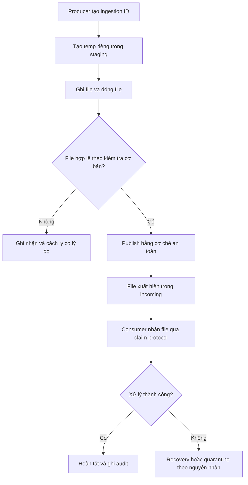

# Safe File Publication — Thiết kế v1

**Loại:** System Design · **Trạng thái:** Proposed  
**Liên quan:** [Knowledge](../01-knowledge/concurrency/file-publication-options.md) · [ADR-001](../03-decisions/ADR-001-file-publication.md)

## 1. Vấn đề

Producer có thể gửi file chậm, crash hoặc chạy song song. Consumer không được đọc file đang ghi dở; producer không được vô tình thay thế file đích; cần biết khi nào phải recovery.

## 2. Mục tiêu và ranh giới

**Mục tiêu:** publish file hoàn chỉnh bằng giao thức rõ ràng, theo dõi từng lần tiếp nhận và tránh overwrite ngoài ý muốn.

**Chưa cam kết trong v1:** exactly-once business effects, crash durability trên mọi filesystem, multi-machine coordination, giao dịch nguyên tử giữa filesystem và metadata.

## 3. Luồng dữ liệu dự kiến



## 4. Quy tắc đề xuất

1. Tạo tên tạm riêng (`mktemp` hoặc cơ chế tạo file với `O_EXCL` phù hợp).
2. Chỉ producer ghi trong staging; consumer không xử lý `.part`.
3. Ghi xong và đóng file trước khi publish; kiểm tra điều kiện tối thiểu.
4. Giữ staging và incoming trên cùng filesystem nếu dùng rename nguyên tử.
5. Tên destination theo ingestion ID để giảm va chạm; với yêu cầu no-overwrite, phải dùng primitive bảo vệ thích hợp, không chỉ `if ! -e`.
6. Tính SHA-256 để đánh dấu *duplicate candidate*; không tự xóa theo hash.
7. Lưu audit record cho từng lần nhận; quy định rõ recovery khi publish thành công nhưng metadata ghi thất bại.

## 5. File lifecycle logic

```text
RECEIVED → PROCESSING → COMPLETED
                    ↘ QUARANTINED (lỗi dữ liệu xác định)
                    ↘ RECOVERY_NEEDED (job/process/infrastructure failure)
```

Directory path chỉ là một phần biểu diễn trạng thái. File trong `processing/` có thể đang chạy **hoặc** là file bị bỏ lại sau crash.

## 6. Failure scenarios

| Tình huống | Nguy cơ | Chính sách dự kiến |
|---|---|---|
| Upload mới được 2/5 GB | Consumer đọc dở | Chỉ đọc tên published |
| Producer bị kill trước publish | `.part` còn lại | Recovery/cleanup có kiểm chứng ownership |
| Hai producer cùng destination | Overwrite | Unique destination và no-overwrite khi cần |
| Consumer chạy trùng | Xử lý lặp | Thiết kế claim/lock ở giai đoạn sau |
| Disk full khi ghi file | Dữ liệu không hoàn chỉnh | Không publish và ghi lỗi; retry có giới hạn |
| Rename thành công, ghi metadata thất bại | File và audit lệch trạng thái | Reconciliation/recovery; không giả định transaction xuyên hệ thống |

## 7. Acceptance tests chưa thực hiện

- [ ] Consumer không đọc file `.part`.
- [ ] Hai producer không ghi chung temporary file.
- [ ] Không vô tình overwrite destination đã tồn tại.
- [ ] File trước publish bị crash vẫn có thể nhận diện để recovery.
- [ ] Gửi lại nội dung trùng vẫn có lịch sử audit riêng.
- [ ] Ghi lại filesystem/mount và kiểm tra giới hạn rename.
- [ ] Chứng minh restart không tạo tác động đầu ra trùng trong phạm vi test được định nghĩa.

**Quan trọng:** Checklist hiện là kế hoạch kiểm chứng, **không phải** kết quả đã pass.
